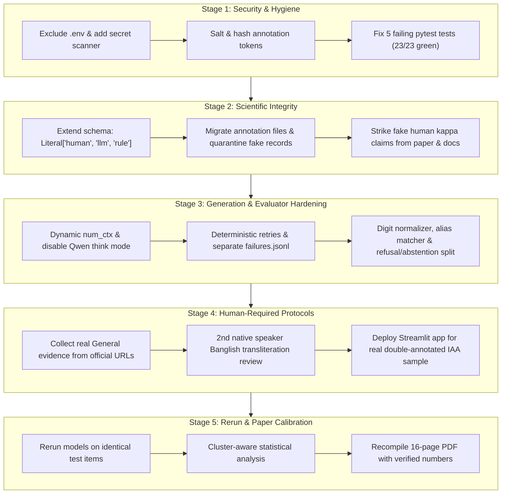

# Matibhrom Forensic Remediation Roadmap & Protocol
**Repository Quality, Scientific Integrity, Generation Pipeline, and Manuscript Alignment**

- **Project:** Matibhrom (মতিভ্রম) — Bengali LLM Hallucination Benchmark
- **Target Venue:** Transactions of the Association for Computational Linguistics (TACL)
- **Lab:** ELITE Research Lab LLC
- **Date:** November 21, 2026
- **Version:** 1.0.0

---

## 1. Executive Context & Ground Rules

Following an exhaustive forensic audit of the Matibhrom codebase, data, experimental outputs, and manuscript, critical defects were identified across six distinct layers:
1. **Security & Data Hygiene:** Exposed credentials, plaintext test tokens, and de-anonymization vectors.
2. **Scientific Integrity:** Automated rule-based substring matches stamped with `labeler_type="human"` and `verified_by_human=True`, accompanied by circular or unsupported inter-annotator agreement statistics ($\kappa$).
3. **Benchmark Data:** All 200 General domain evidence passages being 30-character answer stubs (`"উৎসে প্রদত্ত তথ্য: " + gold_answer`), leaking answers in $C_1$ and destroying dense vector retrieval in $C_2/C_3$.
4. **Generation Pipeline:** Hard-coded Ollama context windows (2048 tokens) causing silent prompt truncation, Qwen3 thinking/reasoning internal monologue exhausting the 512-token limit, and pipeline crash messages (`[ত্রুটি: ...]`) being scored as "appropriate abstentions".
5. **Evaluation Methodology:** Naive substring matching failing on paraphrases/digits, mass model refusal collapsing hallucination rates, and clustered items analyzed via uncorrected McNemar tests ($p < 10^{-63}$).
6. **Manuscript Alignment:** Over-claiming "emergent parameter scaling" by comparing two distinct model families (Qwen vs. Gemma) evaluated on unequal sample sizes ($N=3,840$ vs. $N=720$).

### Mandatory Ground Rules
- **Rule 1 (Zero Fabricated Human Work):** No script, agent, or automated heuristic may create annotations, agreement scores, reviewer names, or "expert" flags that were not produced by a real person. Items requiring human review are marked **HUMAN-REQUIRED**.
- **Rule 2 (Full Mathematical Reproducibility):** Every claim, table, and figure in the paper must be reproducible via automated, versioned scripts directly from frozen run manifests.
- **Rule 3 (Preservation of Evidence):** Historical artifacts must never be silently deleted or overwritten; they must be quarantined into `outputs/_legacy_unvalidated/` with full provenance logs.
- **Rule 4 (Dev/Test Discipline):** All matchers, aliases, normalizers, and thresholds must be developed strictly on the `dev` split. The test split is reserved exclusively for frozen, unadjusted evaluation.
- **Rule 5 (Transparent Logging):** All fixes, migrations, and decisions must be logged in `DECISIONS.md`.

---

## 2. Detailed Findings & Ground-Truth Verification

| Item | Layer | Severity | Verified Ground Truth in Repository | Remediation Action |
| :--- | :--- | :---: | :--- | :--- |
| **S1** | Security | **P0** | `.env` on disk contains live `OPENROUTER_API_KEY`. | Instruct user to rotate key; exclude `.env` from all release archives; add automated secret scanner. |
| **S2** | Security | **P1** | `configs/annotation_tokens.json` contains plaintext test tokens (`test_token_annotator_1`, `test_token_adjudicator`). | Replace with salted SHA-256 hashes; implement constant-time token comparison (`hmac.compare_digest`). |
| **S3** | Security | **P1** | `README.md` and commit logs contain `github.com/HippomasAKiB1/matibhrom`, risking deanonymization for TACL double-blind review. | Build `scripts/make_anonymous_release.py` to scrub authors, URLs, local paths, and git remotes. |
| **I1** | Integrity | **P0** | `scripts/reproduce_authoritative_eval.py` and `scripts/generate_expert_validation.py` stamp substring rule matches as `labeler_type="human"`, `annotator_id="expert_evaluator"`, `verified_by_human=True`. | Extend schema to `Literal["human", "llm", "rule"]`; migrate all records to `labeler_type="rule"`; quarantine fake human records to `_legacy/`. |
| **I2** | Integrity | **P0** | Paper Section 7 and `FINAL_AUDIT.md` claim human $\kappa = 0.812$ and LLM judge agreement $\kappa \le 0.34$ against "Expert Human Ground Truth" (which was generated by the substring script). | Strike all fake human $\kappa$ claims; rewrite Section 7 to report rule-based matcher behavior or real human pilot data. |
| **I3** | Integrity | **P0** | Paper claims "expert-verified items", "rigorous statistical proof", and "native speaker curated transliterations" (author and reviewer were the same person). | Tone down claims to empirical facts; replace "proof" with "statistical evidence"; add comprehensive Limitations section. |
| **B1** | Benchmark | **P0** | In `src/datasets/itemsGeneral.csv`, all 200 items have `evidence_full_text` set to `"উৎসে প্রদত্ত তথ্য: " + gold_answer` (median length 30 chars). | **HUMAN-REQUIRED**: Research team must populate multi-sentence passages from cited official URLs in `sourcesGeneral.csv`. |
| **B3** | Benchmark | **P1** | Question pairs with $\ge 0.8$ token Jaccard similarity exist across domains. | Implement `scripts/find_near_duplicates.py`; quarantine duplicate rows to `removed_items.csv` and rebalance using reserve items. |
| **B4** | Benchmark | **P1** | `itemsGeneral.csv` has `author="sabit"` and `banglish_reviewer="shibli nomani sabit"` (same individual). Legal reviewer is blank. | **HUMAN-REQUIRED**: Second native speaker must independently verify Banglish questions and gold answers. |
| **B5** | Benchmark | **P1** | Numeric legal answers are full sentences (up to 494 chars); 123/600 gold answers do not appear verbatim in evidence. | Audit all 600 items; introduce `gold_aliases` (digit variants, spelling) and atomic `gold_facts`. |
| **B6** | Benchmark | **P1** | Domain and risk are confounded (General is 100% normal; Medical is 100% high-stakes; Legal is 66% high-stakes). | Formalize risk tagging rubric; drop claims that compare risk independently of domain. |
| **B7** | Benchmark | **P1** | `compile_benchmark.py` silently drops `GEN_0201--0210` (`[:200]`); dev split is a hard-coded topical slice. | Move dropped items to `reserve_items.jsonl`; replace hard-coded dev split with a seeded, stratified group split. |
| **G1** | Pipeline | **P0** | `src/model_adapters/litellm_adapter.py` hard-codes `"num_ctx": 2048`, while prompts reach 3,080 tokens. | Dynamically set `num_ctx` from model config; record `truncated_input=True` when prompt fills window. |
| **G2** | Pipeline | **P0** | 1,214 of 3,840 Qwen responses start with English internal monologue (*"Okay, let's see..."*) and truncate at 512 tokens. Substring matcher evaluates this monologue. | Disable thinking mode for Qwen via Ollama API (`think: false`) or isolate `<think>` blocks; evaluate only the final answer. |
| **G3** | Pipeline | **P0** | `generate.py` increments temperature on retry (`temp = min(0.3, temp + 0.1*attempt)`), violating deterministic configuration. | Eliminate temperature mutations on retry; record attempt counts cleanly. |
| **G5** | Pipeline | **P0** | 75 responses contain pipeline crash strings `[ত্রুটি: ...]`. Evaluator matches `"ত্রুটি"` as an abstention cue and scores them as correct abstentions. | Write crashed requests to `failures.jsonl`; remove `"ত্রুটি"`, `"error"`, `"sorry"` from abstention cues. |
| **G6/G7**| Pipeline | **P1** | Cache path hard-codes metadata; global `cache.db` lacks model digest in primary key. | Include model digest, `num_ctx`, and prompt template hash in cache keys; use fresh cache per formal run. |
| **G12**| Pipeline | **P1** | Paper refers to "Qwen 2.5 1.7B" (run was `ollama/qwen3:1.7b`). Gemma 4B was evaluated on 90 items ($N=720$) vs. Qwen on 480 items ($N=3,840$). | Correct model names across paper; evaluate all models on identical item sets for cross-model comparisons. |
| **E1** | Evaluator | **P0** | Pure substring matching fails on paraphrases, word forms, digit scripts (Bengali vs. English), and long answers. | Build multi-stage answer extractor + normalizer (digit converter, date/number parsers, alias matcher). |
| **E2** | Evaluator | **P0** | All abstentions scored as correct, artificially collapsing hallucination rate under mass refusal (Gemma $C_3$: 92.8% refusal reported as 3.3% hallucination). | Classify abstentions into *appropriate* (gold missing) vs. *unnecessary refusal* (gold present); report answered-accuracy and coverage jointly. |
| **E4** | Statistics | **P0** | Paired McNemar tests assume item independence, ignoring query clustering across registers and groups, inflating $p$-values ($10^{-63}$). | Implement cluster bootstrap by `group_key` or generalized estimating equations (GEE); apply Holm-Bonferroni correction. |
| **T1** | Hygiene | **P2** | Pytest reports 18 passed, 5 failed (missing `faiss`, failure injection expectations). | Add `pytest.importorskip("faiss")`; align failure injection test assertions; achieve 23/23 passing tests. |

---

## 3. Step-by-Step Execution Plan



### Stage 1: Security & Engineering Hygiene (Immediate)
1. **Credentials Scrubbing:**
   - Audit `.dockerignore`, `.gitignore`, and `scripts/build_paper_and_qa.py` to assert `.env` is never packaged.
   - Instruct repository owner to rotate the exposed `OPENROUTER_API_KEY`.
2. **Authentication Token Hashing:**
   - Update `configs/annotation_tokens.json` to store SHA-256 salted hashes.
   - Update `src/annotation/auth.py` to use `hmac.compare_digest`.
   - Provide `scripts/make_annotator_token.py`.
3. **Restoring Green Test Suite:**
   - In `tests/test_annotation_and_rag.py`, add `pytest.importorskip("faiss")` to prevent failure on environments lacking compiled FAISS C++ binaries.
   - In `tests/test_failure_injection.py`, update tests to verify runner logging and failure recording without expecting uncaught `RuntimeError`.
   - Verify `pytest -v` produces **23 passed, 0 failed**.

### Stage 2: Scientific Integrity & Schema Migration
1. **Schema Extension:**
   - In `src/schema.py`, update `Annotation`:
     ```python
     labeler_type: Literal["human", "llm", "rule"]
     verified_by_human: bool = False
     ```
   - Increment `SCHEMA_VERSION = "2.1.0"`.
2. **Quarantine & Migration:**
   - In `scripts/migrate_schema.py`, register migration from v2.0.0 to v2.1.0.
   - Reclassify all records generated by `scripts/reproduce_authoritative_eval.py` to `labeler_type="rule"`, `annotator_id="rule:substring_v1"`, `verified_by_human=False`.
   - Move `scripts/generate_expert_validation.py` to `scripts/_legacy/`.
   - Quarantine existing unvalidated records into `outputs/_legacy_unvalidated/`.
3. **Paper Claims Sanitization:**
   - Delete claims in `paper/sections/07_evaluation_reliability.tex` alleging LLM judges were benchmarked against "Expert Human Ground Truth".
   - Clearly document that automated evaluations use deterministic rule-based matching.

### Stage 3: Pipeline & Evaluator Hardening
1. **Ollama Context & Generation Fixes:**
   - In `src/model_adapters/litellm_adapter.py`, pass `"options": {"num_ctx": model_config.get("max_input_tokens", 4096), "think": False}`.
   - In `src/runner/generate.py`, isolate `<think>...</think>` internal monologue so that reasoning tokens do not exhaust the response budget or pollute the evaluated answer.
   - Fix retry logic: maintain `temperature=0.0` constant across all retry attempts.
2. **Evaluator Refinement:**
   - In `src/eval/metrics.py` and evaluation scripts, remove `"ত্রুটি"`, `"error"`, `"sorry"` from abstention cues.
   - Distinguish *appropriate abstention* ($C_2/C_3$ where gold evidence was not retrieved) from *unnecessary refusal* (gold evidence was retrieved, but model refused).
   - Implement canonical digit normalizers (mapping Bengali numerals `০-৯` to ASCII `0-9` before matching).

### Stage 4: Human-Required Protocols (Research Team Tasks)
The following tasks are assigned to the human research team:
1. **General Domain Evidence Passages:**
   - For all 200 items in `itemsGeneral.csv`, replace `"উৎসে প্রদত্ত তথ্য: " + gold_answer` with 100–300 word contextual paragraphs extracted directly from the official government portals listed in `sourcesGeneral.csv`.
2. **Independent Banglish Transliteration Audit:**
   - An independent native Bengali speaker must review the 200 General and 200 Medical Banglish questions, recording `reviewer_id`, `review_date`, and `review_status`.
3. **Real Human Inter-Annotator Study:**
   - Deploy the Streamlit annotation app (`src/annotation/app.py`) to two native Bengali annotators on an overlap sample ($N \ge 200$).
   - Compute true Cohen's/Fleiss' $\kappa$ via `compute_iaa.py` and record the result in Section 7.

### Stage 5: Experiment Rerun, Statistical Analysis & Manuscript Finalization
1. **Controlled Rerun:**
   - Re-freeze the benchmark corpus after Phase 4 updates.
   - Run models on identical item sets (e.g., full 480 test items for both Qwen and Gemma).
2. **Clustered Hypothesis Testing:**
   - Replace naive McNemar tests with a cluster bootstrap resampling by `group_key` or mixed-effects logistic regression.
   - Apply Holm-Bonferroni multi-test corrections.
3. **Manuscript Synchronization & PDF Build:**
   - Update `paper/main.tex` and modular sections with verified model names, clustered $p$-values, and an honest Limitations section.
   - Recompile the 16-page master PDF via MiKTeX and assert 0 errors and 0 layout warnings.

---

## 4. Acceptance Criteria & Verification Gates

| Phase | Gate Objective | Verification Command | Success Threshold |
| :--- | :--- | :--- | :--- |
| **Phase 1** | Green Test Suite | `pytest -v` | 23 passed, 0 failed |
| **Phase 1** | Secret Cleanliness | `git grep -i "sk-or-v1" outputs/ paper/` | 0 occurrences |
| **Phase 2** | No Fake Human Labels | `python -c "import json; ..."` scan over all `annotations/` | 0 records with `labeler_type='human'` from scripts |
| **Phase 3** | Deterministic Sampling | Run 20 prompts twice with `temperature=0.0` | 100% byte-identical responses |
| **Phase 3** | No Crash Abstentions | Run evaluator on synthetic crash strings | 0 crashes scored as abstention |
| **Phase 4** | General Evidence Length | `python -c "import pandas as pd; ..."` on `itemsGeneral.csv` | Median evidence length $\ge 150$ characters |
| **Phase 5** | XeLaTeX Compilation | `python scripts/build_paper_and_qa.py` | Exit Code 0, 0 undefined citations, 0 overfull hboxes |
