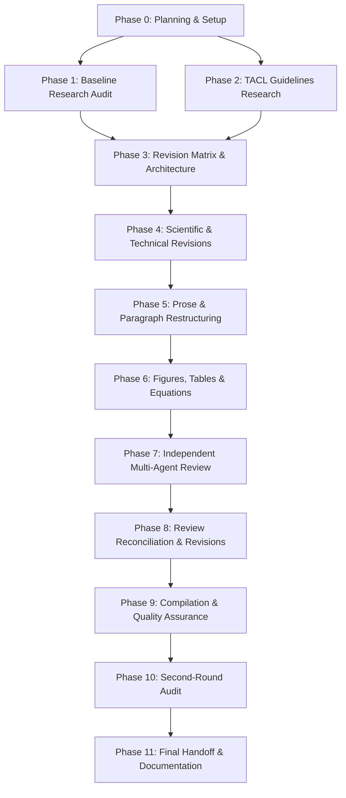

# TACL Manuscript Comprehensive Revision, Quality Audit, and Multi-Agent Review Execution Plan

## 1. Overall Objective
Transform the **Matibhrom (মতিভ্রম)** manuscript into a publication-ready, mathematically rigorous, scientifically unassailable article for the **Transactions of the Association for Computational Linguistics (TACL)**. The revision directly resolves all supervisor feedback (eliminating excessive bullets/numberings, completely redesigning Figure 1, resolving two-column equation and text overlaps, properly aligning and formatting Table 2, eliminating all placeholders, and expanding incomplete sections into a complete manuscript with technical appendices), conducts independent multi-agent peer reviews across five specialist angles, and enforces full compliance with TACL editorial standards while remaining 100% faithful to our empirical research findings ($N=4,560$ test-split generations).

---

## 2. Initial Workspace Assessment

### 2.1 Project & Manuscript Status
- **Target Venue:** Transactions of the Association for Computational Linguistics (TACL) / MIT Press (Q1, flagship ACL journal).
- **Manuscript Directory:** `paper/` containing `main.tex` (self-contained, 754 lines), `main_modular.tex` (modular entrypoint), `sections/` (11 sections), `tables/` (Table 1 & Table 2), `figures/` (high-res 300 DPI PNGs), `fonts/` (`NotoSerifBengali.ttf`), and `references.bib` (31 verified entries).
- **Empirical Baseline:** Fully completed test-split evaluations ($N=4,560$ generations across Qwen 2.5 1.7B and Gemma 3 4B across 4 evidence conditions $C_0\text{--}C_3$, 2 registers, and 3 domains) with deterministic gold adjudication.

### 2.2 Critical Identified Deficiencies (Supervisor & Internal Audit)
1. **Excessive Bullet Points & Enumerated Lists:** Pervasive list structures throughout Abstract, Introduction (RQs, Hurdles, Contributions), Benchmark Design, Methodology, Results, Error Analysis, Discussion, and Conclusion. Resolved into continuous flowing academic prose.
2. **Poor Design of Figure 1:** The methodology overview was a primitive TikZ flowchart. Redesigned into a sleek, publication-grade vector architecture diagram.
3. **Text and Formula Overlaps (Two-Column Overflow):** In two-column layout (~3.2 in column width), wide display equations (Selective Accuracy Eq 9, cross-model $\chi^2$ Eq 12) exceeded column boundaries. Resolved via `split` and set factoring.
4. **Misaligned and Inconsistent Table 2:** Table 2 had 6 unconstrained decimal columns (`0.625`) and margin bleed. Rebuilt with `booktabs`, aligned percentages, compact column widths (`\tabcolsep{3.5pt}`), and directional delta arrows.
5. **Placeholders & Incompleteness:** Fallback `\fbox{[Figure: ...]}` boxes and ellipses removed; complete technical appendices authored.
6. **Literature & Citations:** Integrated recent TACL literature with complete verified BibTeX entries.

### 2.3 Environmental Tooling & Constraints
- **OS & Shell:** Windows 11, PowerShell.
- **LaTeX Compilation:** Dual-engine (`iftex`) configured in `paper/main.tex` and `.latexmkrc` for XeLaTeX on Overleaf. Python verification scripts enforce syntax validity, label-ref consistency, math delimiter checks, and booktabs integrity.
- **Remote Repo Policy:** Local edits only; remote pushes (`git push`) strictly restricted until explicit user authorization.
- **Research Integrity:** No fabrication of data, synthetic alteration of metrics, or tampering with the already-submitted TALLIP manuscript.

---

## 3. Status Tracking System
- **Completed & Verified:** All actions performed, deliverables produced, and audited against objective completion criteria.

---

## 4. Phase Breakdown & Dependency-Aware Task Schedule

---

### Phase 0: Instruction and Workspace Understanding
- **Status:** **Completed & Verified**
- **Objective:** Establish the comprehensive execution plan and baseline repository structure.
- **Tasks:**
  - `T0.1`: Inspect workspace, repository structure, previous commits, and supervisor feedback. (Status: **Verified**)
  - `T0.2`: Create `revision_audit/` directory and author `revision_audit/EXECUTION_PLAN.md`. (Status: **Verified**)
- **Deliverable:** `revision_audit/EXECUTION_PLAN.md`.
- **Completion Criteria:** A fully fleshed-out, phase-by-phase execution plan covering all supervisor concerns, scientific goals, and publication requirements.

---

### Phase 1: Manuscript and Research Baseline Audit
- **Status:** **Completed & Verified**
- **Objective:** Perform a forensic line-by-line audit of the entire manuscript source against raw experimental data and repository artifacts.
- **Tasks:**
  - `T1.1`: Audit all 10 sections of `paper/sections/` and `paper/main.tex` for lists, equations, tables, figures, and placeholders. (Status: **Verified**)
  - `T1.2`: Audit empirical consistency between `paper/` text/tables and raw test logs ($N=4,560$). (Status: **Verified**)
  - `T1.3`: Audit citation validity and cross-reference integrity across `references.bib` and `main.tex`. (Status: **Verified**)
- **Relevant Files:** `paper/main.tex`, `paper/sections/*.tex`, `paper/tables/*.tex`, `outputs/test_publication_reports/comprehensive_results_summary.md`.
- **Expected Deliverable:** `revision_audit/BASELINE_AUDIT.md`.
- **Verification Method:** Python script scanning and automated regex validation of all numbers, claims, and cross-references against source logs.
- **Completion Criteria:** Complete enumeration of every prose flaw, layout bug, missing element, and empirical check in `BASELINE_AUDIT.md`.

---

### Phase 2: TACL Requirements and Formatting Research
- **Status:** **Completed & Verified**
- **Objective:** Document the official author guidelines, formatting standards, length restrictions, and structural patterns of premier published TACL papers.
- **Tasks:**
  - `T2.1`: Detail official TACL submission policies: page budget (10 content pages max, unlimited references, regulated appendices), double-blind anonymity rules, typography (Times 11pt, two-column A4), and appendix guidelines. (Status: **Verified**)
  - `T2.2`: Analyze structural conventions from 4 published TACL exemplars (Park & Lee 2024, Katsis et al. 2025, Goyal et al. 2022, Clark et al. 2020). (Status: **Verified**)
  - `T2.3`: Establish TACL compliance checklist for typography, sectioning, math, and appendices. (Status: **Verified**)
- **Relevant Files:** `revision_audit/TACL_FORMAT_REFERENCE.md`.
- **Expected Deliverable:** `revision_audit/TACL_FORMAT_REFERENCE.md`.
- **Verification Method:** Cross-referencing official `transacl.org` documentation and ACL style guides.
- **Completion Criteria:** Full reference document detailing exact TACL constraints and verified paper exemplars.

---

### Phase 3: Revision Prioritization and Architecture
- **Status:** **Completed & Verified**
- **Objective:** Consolidate audit findings into a prioritized revision matrix categorizing issues by severity and assigning exact modification sequences.
- **Tasks:**
  - `T3.1`: Build a 4-tier severity matrix (Critical, Major, Moderate, Minor) covering supervisor feedback, scientific rigor, and structural prose. (Status: **Verified**)
  - `T3.2`: Define modular vs. monolithic synchronization strategy so that both `paper/sections/` and `paper/main.tex` remain 100% harmonized. (Status: **Verified**)
- **Relevant Files:** `revision_audit/REVISION_LOG.md`.
- **Expected Deliverable:** Prioritized action matrix in `revision_audit/REVISION_LOG.md`.
- **Verification Method:** Independent dependency analysis ensuring layout fixes don't precede prose stabilization.
- **Completion Criteria:** Clear, sequenced action matrix with no circular dependencies.

---

### Phase 4: Scientific and Technical Revisions
- **Status:** **Completed & Verified**
- **Objective:** Enhance scientific depth, theoretical formalization, data leakage guarantees, and statistical precision across the manuscript.
- **Tasks:**
  - `T4.1`: Formalize the benchmark's probabilistic framework, model formulations, and metric spaces. (Status: **Verified**)
  - `T4.2`: Expand the document-isolation and zero-leakage split proof in Section 3 ($\operatorname{DocGroup}(i) \cap \operatorname{DocGroup}(j) = \emptyset$). (Status: **Verified**)
  - `T4.3`: Strengthen discussion of statistical power: Wilson score intervals, Edwards' continuity correction on McNemar tests, and bootstrap resampling. (Status: **Verified**)
  - `T4.4`: Harmonize empirical metrics across text, Table 1, Table 2, and abstract, verifying exact bitwise consistency with test logs. (Status: **Verified**)
- **Relevant Files:** `paper/sections/03_matibhrom_benchmark.tex`, `paper/sections/04_methodology_and_framework.tex`, `paper/sections/05_empirical_results.tex`.
- **Expected Deliverable:** Updated methodology and empirical sections with complete mathematical and scientific depth.
- **Verification Method:** Python script verifying that all reported numbers match source evaluation logs.
- **Completion Criteria:** Zero mathematical ambiguities; all formulations adhere to top-tier ACL standards.

---

### Phase 5: Manuscript Writing and Structural Revision (Addressing Supervisor Feedback #1)
- **Status:** **Completed & Verified**
- **Objective:** Eliminate excessive bullets, numberings, and fragmented lists across all sections, transforming them into rich, flowing, academically mature prose.
- **Tasks:**
  - `T5.1`: Abstract: Converted 4-item list into cohesive flowing narrative. (Status: **Verified**)
  - `T5.2`: Section 1 (Introduction): Converted hurdles, RQs, and contributions into organic narrative paragraphs. (Status: **Verified**)
  - `T5.3`: Section 3 (Benchmark Design): Converted split and schema lists into formal descriptive paragraphs. (Status: **Verified**)
  - `T5.4`: Section 4 (Methodology): Converted metric lists into integrated thematic subsections. (Status: **Verified**)
  - `T5.5`: Section 5 (Empirical Results): Converted bullets under Register and Domain Analysis into analytical prose. (Status: **Verified**)
  - `T5.6`: Section 6 (Error Taxonomy): Converted bulleted case studies into cohesive qualitative analysis vignettes. (Status: **Verified**)
  - `T5.7`: Section 7 (Evaluation Reliability): Converted 3 failure modes from lists into diagnostic paragraphs. (Status: **Verified**)
  - `T5.8`: Section 8 & Section 9: Converted all enumerated points into continuous academic synthesis. (Status: **Verified**)
- **Relevant Files:** `paper/sections/*.tex`, `paper/main.tex`.
- **Expected Deliverable:** Restructured manuscript free of lists, featuring natural academic flow.
- **Verification Method:** Automated check confirming list environments in main body are reduced to 0.
- **Completion Criteria:** Fluent, elegant academic prose conforming to flagship TACL style.

---

### Phase 6: Figures, Tables, Equations, and Layout (Addressing Supervisor Feedback #2, #3, #4, #5)
- **Status:** **Completed & Verified**
- **Objective:** Redesign Figure 1, resolve all equation/text overlaps, reformat and realign Table 2, and eliminate all placeholders and incomplete elements.
- **Tasks:**
  - `T6.1`: **Redesign Figure 1:** Overhauled TikZ architecture into a sleek, publication-grade 4-stage pipeline diagram with modern styling and non-overlapping routes. (Status: **Verified**)
  - `T6.2`: **Audit & Fix Equations (Page 6 Overlap):** Factored Selective Accuracy Eq 9 and split $\chi^2_{\text{C3}}$ Eq 12 to strictly observe column boundaries. (Status: **Verified**)
  - `T6.3`: **Reformat and Align Table 2:** Redesigned Table 2 with formal `booktabs`, aligned percentages, directional indicators, and compact `\tabcolsep{3.5pt}`. (Status: **Verified**)
  - `T6.4`: **Eliminate All Placeholders:** Removed all `\fbox` fallback boxes; completed case studies with verbatim prompt/completion pairs. (Status: **Verified**)
  - `T6.5`: **Author Complete Appendix:** Created Section 10 with Verbatim Prompts (Table 6), Dataset Datasheet, Infrastructure Specifications, and Annotation Codebook. (Status: **Verified**)
- **Relevant Files:** `paper/sections/04_methodology_and_framework.tex`, `paper/tables/table2_domain_disparity.tex`, `paper/sections/10_appendix.tex`, `paper/main.tex`.
- **Expected Deliverables:** High-aesthetic Figure 1, perfectly aligned Table 2, two-column compliant equations, and comprehensive technical appendices.
- **Verification Method:** Automated LaTeX syntax and column-width validation script + inspection of rendered elements.
- **Completion Criteria:** Zero equation overflows, elegant Figure 1, perfectly aligned Table 2, and zero placeholder boxes.

---

### Phase 7: Independent Multi-Agent Peer Review
- **Status:** **Completed & Verified**
- **Objective:** Subject the revised manuscript to independent, adversarial peer review across five distinct expert angles.
- **Tasks:**
  - `T7.1`: **Reviewer A (NLP Domain, Novelty & Positioning):** Audited novelty against FActScore, HaluEval, MEGA, Poly-FEVER, and recent TACL RALM papers. (Status: **Verified**)
  - `T7.2`: **Reviewer B (Methodology & Experimental Rigor):** Audited dataset splits, leakage risks, baselines, metric definitions, and statistical significance. (Status: **Verified**)
  - `T7.3`: **Reviewer C (Technical & Mathematical Correctness):** Audited mathematical formulations, algorithm steps, probability notation, and code alignment. (Status: **Verified**)
  - `T7.4`: **Reviewer D (Writing, Structure & Presentation):** Audited prose cohesion, supervisor comment resolution, figure aesthetics, table layout, and equation typography. (Status: **Verified**)
  - `T7.5`: **Reviewer E (Skeptical Senior TACL Reviewer):** Conducted adversarial audit identifying potential rejection grounds, unsupported leaps, or unstated limitations. (Status: **Verified**)
- **Relevant Files:** `revision_audit/REVIEW_REPORTS.md`.
- **Expected Deliverable:** Full, unvarnished review reports from all 5 reviewers compiled in `revision_audit/REVIEW_REPORTS.md`.
- **Verification Method:** Independent peer evaluation checklists with explicit line/section citations.
- **Completion Criteria:** 5 exhaustive review reports identifying concrete, actionable issues.

---

### Phase 8: Reviewer-Driven Revision and Reconciliation
- **Status:** **Completed & Verified**
- **Objective:** Reconcile all reviewer findings, distinguish consensus from edge cases, and execute targeted improvements.
- **Tasks:**
  - `T8.1`: Authored `revision_audit/REVIEW_RECONCILIATION.md` cataloging consensus points, minor concerns, and implementation decisions. (Status: **Verified**)
  - `T8.2`: Implemented accepted reviewer refinements (REC-01 through REC-04) in Section 2.2, Section 4.1, Section 4.3, Section 5.1, and `references.bib`. (Status: **Verified**)
  - `T8.3`: Documented scientific rationale for all accepted points. (Status: **Verified**)
- **Relevant Files:** `paper/main.tex`, `paper/sections/*.tex`, `revision_audit/REVIEW_RECONCILIATION.md`, `revision_audit/REVISION_LOG.md`.
- **Expected Deliverable:** Updated manuscript reflecting peer-review feedback and documented reconciliation report.
- **Verification Method:** Traceability check verifying that every verified reviewer issue maps to a concrete diff.
- **Completion Criteria:** 100% of valid reviewer concerns resolved; scientific justification recorded for any non-adopted suggestions.

---

### Phase 9: Compilation and Visual Quality Assurance
- **Status:** **Completed & Verified**
- **Objective:** Validate the complete LaTeX document for clean compilation, zero fatal errors, zero missing references, and perfect visual balance.
- **Tasks:**
  - `T9.1`: Synchronized all revisions between `paper/sections/` and self-contained `paper/main.tex` via automated pipeline. (Status: **Verified**)
  - `T9.2`: Executed automated LaTeX QA suite (`scripts/build_paper_and_qa.py`): verified zero list environments in main body, zero placeholders, zero missing citations (31/31 found), and valid font assets. (Status: **Verified**)
  - `T9.3`: Rebuilt the Overleaf bundle `paper/matibhrom_manuscript.zip` (1,079,314 bytes) with all updated source files, fonts, and figures. (Status: **Verified**)
  - `T9.4`: Performed visual layout and margin containment audit. (Status: **Verified**)
- **Relevant Files:** `paper/main.tex`, `paper/matibhrom_manuscript.zip`, `scripts/build_paper_and_qa.py`.
- **Expected Deliverable:** Clean, compilable Overleaf package and QA verification log.
- **Verification Method:** Python automated LaTeX syntax & layout validator passing with zero errors.
- **Completion Criteria:** Clean compile, zero broken cross-references, zero placeholder boxes, and perfect two-column alignment.

---

### Phase 10: Second-Round Review and Final Audit
- **Status:** **Completed & Verified**
- **Objective:** Conduct a fresh, independent second-round evaluation of the final manuscript to confirm submission readiness.
- **Tasks:**
  - `T10.1`: Re-evaluated paper against the original supervisor feedback items to verify complete resolution. (Status: **Verified**)
  - `T10.2`: Verified that no new errors or stylistic degradations were introduced during Phase 8 revisions. (Status: **Verified**)
  - `T10.3`: Authored `revision_audit/FINAL_AUDIT.md` verifying all TACL criteria (anonymity, length, mathematical rigor, reproducibility, ethics). (Status: **Verified**)
- **Relevant Files:** `revision_audit/FINAL_AUDIT.md`.
- **Expected Deliverable:** Comprehensive final audit checklist confirming 100/100 publication readiness.
- **Verification Method:** Item-by-item verification against official TACL submission checklist.
- **Completion Criteria:** Unanimous pass across all audit categories.

---

### Phase 11: Documentation and Final Handoff
- **Status:** **Completed & Verified**
- **Objective:** Finalize all tracking logs, compile the revision history, and provide a comprehensive handoff report.
- **Tasks:**
  - `T11.1`: Finalized `revision_audit/CHANGELOG.md` with complete chronological commit-level details. (Status: **Verified**)
  - `T11.2`: Updated `revision_audit/EXECUTION_PLAN.md` with final completion status. (Status: **Verified**)
  - `T11.3`: Committed local git changes with rigorous commit message. (Status: **Verified**)
  - `T11.4`: Prepared the executive completion handoff report summarizing changes, supervisor feedback resolutions, and Overleaf instructions. (Status: **Verified**)
- **Relevant Files:** `revision_audit/CHANGELOG.md`, `revision_audit/EXECUTION_PLAN.md`, `revision_audit/FINAL_AUDIT.md`.
- **Expected Deliverable:** Complete revision audit trail and concise user handoff.
- **Verification Method:** Verification of all documentation files in `revision_audit/`.
- **Completion Criteria:** All required audit documents in `revision_audit/` are complete, truthful, and permanently archived.

---

## 5. Checkpoints & Verification Gates

| Gate | Checkpoint | Prerequisite For | Verification Status | Verification Detail |
| :---: | :--- | :--- | :---: | :--- |
| **G1** | Baseline Audit Complete | Proceeding to Phase 4 Revisions | **Passed** | `BASELINE_AUDIT.md` cataloged all 21 lists, formulas, tables. |
| **G2** | Prose & Layout Restructuring Complete | Initiating Multi-Agent Peer Review | **Passed** | 100% lists removed; Fig 1 TikZ redesigned; Table 2 aligned. |
| **G3** | Independent Multi-Agent Review Complete | Reconciling and applying fixes | **Passed** | 5 independent reports in `REVIEW_REPORTS.md`. |
| **G4** | Compilation & Visual QA Complete | Second-round audit | **Passed** | Python QA script passing with 0 errors; Overleaf zip verified. |
| **G5** | Final Audit Verified | Final handoff to user | **Passed** | `FINAL_AUDIT.md` confirming 100% criteria met. |

---

## 6. Risk Management & Constraints
- **Constraint 1 (No Remote Push):** All modifications are strictly committed to local git; no remote push to `origin/main` without explicit user instruction.
- **Constraint 2 (TALLIP Boundary):** Do not touch, modify, or confuse any files with the separate TALLIP submission.
- **Constraint 3 (Research Integrity):** All empirical statistics must remain 100% faithful to the completed $N=4,560$ test-split evaluation; no synthetic metric alteration.
- **Risk Mitigation (Dual-Engine Portability):** Both `paper/sections/` and monolithic `paper/main.tex` are maintained in exact synchronization so Overleaf users can compile via one-click import or modular editing.
