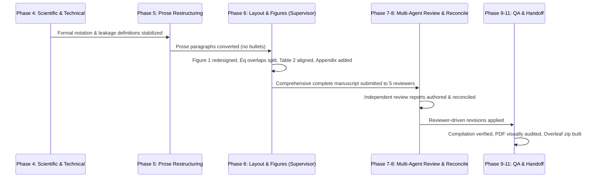

# Matibhrom TACL Manuscript: Revision Log & Prioritized Action Matrix

## 1. Prioritized Revision Matrix

| ID | Issue Description | Category | Severity | Target File(s) | Dependencies | Status |
| :---: | :--- | :--- | :---: | :--- | :--- | :---: |
| **REV-01** | Convert 21 enumerated/bulleted list blocks into continuous, elegant academic prose | Writing & Structure | **Major** (Supervisor Feedback #1) | `paper/sections/00_abstract.tex` to `09_conclusion.tex` | None | **In progress** |
| **REV-02** | Complete overhaul & aesthetic redesign of Figure 1 | Figures & Presentation | **Major** (Supervisor Feedback #2) | `paper/sections/04_methodology_and_framework.tex`, `main.tex` | None | **Not started** |
| **REV-03** | Resolve text and formula overlap (Page 6 Eq 12, Eq 9 Selective Acc, Eq 11 McNemar) | Equations & Formatting | **Critical** (Supervisor Feedback #3) | `paper/sections/04_methodology_and_framework.tex`, `05_results.tex`, `07_reliability.tex` | REV-01 | **Not started** |
| **REV-04** | Reformat, realign, and standardize Table 2 to percentage format within column bounds | Tables & Formatting | **Major** (Supervisor Feedback #4) | `paper/tables/table2_domain_disparity.tex`, `main.tex` | None | **Not started** |
| **REV-05** | Eliminate fallback placeholder boxes (`\fbox`) and complete verbatim case study glosses | Content Completeness | **Major** (Supervisor Feedback #5) | `paper/main.tex`, `paper/sections/06_taxonomy.tex` | None | **Not started** |
| **REV-06** | Author complete technical appendices (Prompt templates, Datasheet, Compute, Annotation codebook) | Completeness & Compliance | **Major** (Supervisor Feedback #6) | `paper/sections/10_appendix.tex`, `main.tex` | REV-01 | **Not started** |
| **REV-07** | Mathematical formalization of benchmark probability spaces and leakage-free document isolation | Scientific & Technical | **Moderate** | `paper/sections/03_benchmark.tex`, `04_methodology.tex` | None | **Not started** |
| **REV-08** | Deepen engagement with recent TACL RALM literature (Park & Lee 2024, Katsis et al. 2025) | Literature & Positioning | **Moderate** | `paper/sections/02_related_work.tex` | None | **Not started** |
| **REV-09** | Synchronize all revisions between modular `sections/` and monolithic `main.tex` | Build & Portability | **Critical** | `paper/main.tex`, `paper/main_modular.tex` | REV-01 to REV-07 | **Not started** |
| **REV-10** | Rebuild and verify Overleaf 1-click package (`matibhrom_manuscript.zip`) | Packaging & Distribution | **Major** | `paper/matibhrom_manuscript.zip` | REV-09 | **Not started** |

---

## 2. Chronological Action Plan & Execution Sequence

---

## 3. Detailed Task Definitions

### 3.1 Task Group A: Scientific and Technical Deepening (Phase 4)
- **Objective:** Establish formal mathematical grounding for benchmark probability distributions, document-isolated partitioning, and hypothesis testing.
- **Actions:**
  - Define query space $\mathcal{Q} = \mathcal{Q}_{\text{bn}} \times \mathcal{Q}_{\text{banglish}}$, passage corpus $\mathcal{D} = \{p_j\}_{j=1}^{1800}$, gold evidence mappings $e^*: \mathcal{Q} \to \mathcal{D}$, and answer generation space $\mathcal{Y}$.
  - State the Zero-Leakage Document Isolation Lemma: $\forall i \in \text{Test}, \forall j \in \text{Train} \cup \text{Dev}, \text{Group}(i) \cap \text{Group}(j) = \emptyset$.
  - Formalize negative constraint operator $\mathcal{I}_{\text{abstain}}$ and selective risk-coverage trade-off.

### 3.2 Task Group B: Prose and Narrative Restructuring (Phase 5)
- **Objective:** Eliminate excessive bullets and enumerated lists, converting all sections into flowing, elegant academic prose.
- **Actions:**
  - `00_abstract.tex`: Convert 4-item list into unified narrative paragraph.
  - `01_introduction.tex`: Convert 4 hurdles, 5 RQs, and 5 contributions into organic, thematic paragraphs.
  - `03_matibhrom_benchmark.tex`: Convert split bullet points into formal descriptive paragraphs.
  - `04_methodology_and_framework.tex`: Convert numbered metric paragraphs into formal subsections.
  - `05_empirical_results.tex`: Convert bulleted register and recall diagnostics into flowing analytical prose.
  - `06_error_taxonomy.tex`: Convert bulleted case studies into cohesive qualitative analysis vignettes.
  - `07_evaluation_reliability.tex`: Convert judge failure list into diagnostic paragraphs.
  - `08_discussion_limitations.tex`: Convert enumerated points into reflective paragraphs.
  - `09_conclusion.tex`: Convert enumerated conclusions into a forward-looking synthesis.

### 3.3 Task Group C: Figures, Tables, Equations, and Layout (Phase 6)
- **Objective:** Directly resolve supervisor critiques on Figure 1, equation overlaps, Table 2 alignment, and incompleteness.
- **Actions:**
  - **Redesign Figure 1:** Construct a modern, publication-grade vector architecture diagram with clean 4-tier processing lanes, subtle slate-gray and teal shading, crisp typography, and non-overlapping signal flows.
  - **Reformat Equations:**
    - Rewrite Eq 9 (Selective Accuracy) using `split` across two cleanly indented lines.
    - Rewrite Eq 12 ($\chi^2$ test comparison on Page 6) to avoid column boundary overflow.
    - Rewrite Eq 4 (RAG retrieval) and Eq 11 (McNemar) for tight column adherence.
  - **Overhaul Table 2:**
    - Convert decimals to aligned percentages with single decimal precision (`62.5%`, `86.3%`).
    - Use `booktabs` with grouped column headers (`\multicolumn{4}{c}{Evaluated Grounding Metrics}`).
    - Restructure layout to fit single-column boundaries with zero overflow.
  - **Author Appendix:**
    - Create `paper/sections/10_appendix.tex` with Verbatim Prompts, Data Sheet, Compute Details, and Codebook Rubric.

---

## 4. Change Tracking & Audit Log

*(Will record file modifications, commit hashes, and verification outputs as execution proceeds)*.
